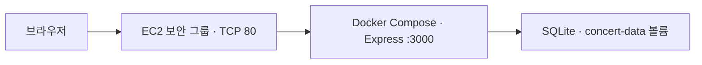

# Concert Ticketing - 콘서트 티켓 예매 웹서비스

> **클라우드컴퓨팅 Ch.10 AWS 프로젝트 적용 과제**  
> **진행 순서: 로컬 개발 → 로컬 기능·Docker 검증 → GitHub 반영 → AWS EC2 배포 → AWS 배포 주소에서 재검증.**

## 1. 서비스 소개

**Concert Ticketing**은 사용자가 콘서트 공연 목록을 확인하고, 좌석을 선택해 예매하며, 자신의 예매 내역을 확인하거나 취소할 수 있는 웹서비스입니다. 인기 공연의 예매 오픈 직후 사용자가 몰리는 상황을 가정하여, **좌석 중복 예매 방지**와 클라우드 확장 가능성을 학습합니다.

- **대상 사용자:** 콘서트 관람을 원하는 일반 사용자
- **해결하려는 문제:** 공연 정보 탐색과 좌석 선택·예매를 한 화면에서 처리하고, 다수의 사용자가 같은 좌석을 동시에 예매하지 않도록 함
- **과제용 범위:** 모의 티켓팅 서비스. 실제 결제·개인정보 수집·실제 티켓 발급은 구현하지 않음

### 주요 기능

| 번호 | 사용자 기능 | 화면에서의 실행 방법 | 기대 결과 |
|---|---|---|---|
| 1 | 공연 목록 및 상세 조회 | 공연 카드 선택 | 공연 정보, 공연 날짜, 예매 가능 좌석 표시 |
| 2 | 좌석 선택 및 예매 | 빈 좌석 선택 → 닉네임 입력 → 예매 버튼 클릭 → 보안문자 입력 | 예매번호 발급 및 해당 좌석 예약 처리 |
| 3 | 예매 내역 조회 | 예매번호 입력 → 조회 버튼 클릭 | 예약한 공연·좌석·상태 표시 |
| 4 | 예매 취소 | 예매번호 조회 → 취소 버튼 클릭 | 예약 취소 및 좌석 재오픈 |
| 5 | 예매 입장 대기열 | 예매 가능 인원이 가득 찬 상태에서 예매하기 선택 | 대기번호 표시, 순서가 되면 예매 화면 입장 |

**접속 집중 시나리오:** 인기 콘서트 티켓 오픈 직후 다수의 브라우저가 예매 화면 입장을 시도하거나 동일 좌석 예매를 동시에 요청하는 상황.

**대기열 범위:** 사이트 전체의 네트워크 접속 수 제한이 아니라 **예매 화면 활성 입장 수**를 제한합니다. 공연 목록은 대기 없이 볼 수 있도록 설계합니다.

### 동시성 및 검증 방침

- 좌석 상태는 브라우저가 아니라 **서버에서 최종 확인**합니다.
- `seats` 테이블에서 `(concert_id, seat_id)`를 고유하게 관리하고, 예약 처리 시 트랜잭션 안에서 **비어 있는 좌석만 조건부 UPDATE**해 선점합니다. 성공한 한 요청만 `reservations`에 저장합니다.
- 취소할 때는 해당 예약을 `cancelled`로 기록하고 같은 트랜잭션에서 좌석 점유를 해제해 **취소 이력을 보존하면서 재예매**를 허용합니다.
- 대기열은 서버가 입장 토큰·대기 순서·만료 시간을 관리하고, 예매 요청에도 유효한 입장 권한을 확인하도록 계획합니다. 새로고침/중복 요청으로 대기 순서가 중복 발급되지 않도록 처리합니다.
- 프런트엔드의 좌석 표시 상태는 참고용이며, 실제 예매 승인 여부는 API 응답으로 결정합니다.
- 본 과제는 모의 예매 시스템이며, 실제 결제 기능은 포함하지 않습니다.

### 샘플 공연

공연일은 2026년 12월 20일이며 시간은 한국 시간(UTC+9) 기준입니다.

| 공연 | 무대 | 시간 | 좌석 |
| --- | --- | --- | ---: |
| 샘플 콘서트 01 · 기타리스트 | 스테이지 1 | 14:00 | 5 |
| 샘플 콘서트 02 · 밴드 | 스테이지 2 | 17:00 | 15 |
| 샘플 콘서트 03 · 여성 보컬 | 스테이지 3 | 18:30 | 30 |

## 2. 사용 기술

| 분류 | 기술 | 사용 목적 |
|---|---|---|
| 프런트엔드 | HTML5, CSS3, Vanilla JavaScript | 페이지·스타일·사용자 동작·Fetch API 요청 |
| 백엔드 | Node.js, Express | REST API, 예매·취소 처리, 정적 페이지 제공 |
| 데이터베이스 | SQLite (`better-sqlite3`) | 공연·좌석·예매 데이터 저장, 트랜잭션 처리 |
| 버전 관리 | Git, GitHub (Public) | 소스 코드 보존 |
| 배포 | AWS EC2 (Ubuntu) | 웹 서버 운영 및 외부 접속 |
| 실행 관리 | Docker, Docker Compose | 로컬 및 EC2에서 동일한 실행 방식 유지 |

> **선택 근거:** HTML·CSS·JavaScript로 사용자 인터페이스를 만들고, 서버에서도 JavaScript(Node.js)를 활용해 학습 부담을 줄입니다. 좌석 점유·취소 데이터를 브라우저별로 공유해야 하므로 정적 페이지뿐 아니라 API와 데이터베이스가 필요합니다. SQLite는 과제용 단일 EC2 구성에 적합합니다. 향후 다중 인스턴스로 확장한다면 공유형 RDS(PostgreSQL 등)로 전환해야 합니다.

## 3. 프로젝트 구조

```text
Week10_Workout/
├── README.md                       # 프로젝트 안내
├── .gitignore
├── .dockerignore
├── .env.example                    # 환경변수 값 예시
├── Dockerfile                      # 백엔드 실행 이미지
├── compose.yaml                    # 앱 및 영속 볼륨 설정
├── package.json                    # 실행 명령 및 의존성
├── package-lock.json
├── public/                         # HTML / CSS / JavaScript 프런트엔드
│   ├── index.html                  # 공연 목록
│   ├── concert.html                # 공연 상세 및 좌석 선택
│   ├── reservation.html            # 예매 내역 조회 및 취소
│   ├── waiting.html                # 입장 대기
│   ├── css/
│   │   └── style.css               # 공통 스타일
│   ├── images/
│   │   ├── concert-hero.jpg        # 배너 이미지
│   │   ├── concert-poster01.jpg    # 포스터 이미지01
│   │   ├── concert-poster02.jpg    # 포스터 이미지02
│   │   └── concert-poster03.jpg    # 포스터 이미지03
│   └── js/
│       ├── api.js                  # Fetch API 공통 요청
│       ├── index.js                # 공연 목록 로딩
│       ├── concert.js              # 좌석 표시·예매 요청
│       ├── reservation.js          # 예매 조회·취소
│       └── waiting.js              # 대기번호·상태 갱신
├── server/
│   ├── app.js                      # Express 앱 진입점, 정적 파일 서빙
│   ├── db.js                       # SQLite 연결 및 초기 데이터
│   ├── routes/
│   │   ├── concerts.js             # 공연·좌석 조회 API
│   │   ├── reservations.js         # 예매·조회·취소 API
│   │   └── queue.js                # 대기열 입장·상태 API
│   └── services/
│       ├── booking.js              # 6자리 보안문자 발급·검증
│       └── queue.js                # 활성 입장·순서·만료 처리
└── data/                           # SQLite 파일 (Git 추적 제외)
```

## 4. AWS 배포 구성 및 환경

기존에 사용하던 **AWS EC2 인스턴스 1대**를 재사용합니다.



1. EC2 콘솔에서 인스턴스의 현재 퍼블릭 IPv4를 확인합니다. 보안 그룹에서 관리자 IP의 SSH `22/tcp`와 시연에 필요한 웹 포트 `80/tcp`를 허용합니다.
2. Windows PowerShell에서 OpenSSH로 접속합니다. `EC2_PUBLIC_IP`는 확인한 주소로 바꿉니다. PuTTY를 쓰는 경우 기존 PEM을 PuTTYgen에서 PPK로 변환해 같은 주소에 접속할 수 있습니다. [AWS SSH 안내](https://docs.aws.amazon.com/AWSEC2/latest/UserGuide/connect-linux-inst-ssh.html) · [AWS PuTTY 안내](https://docs.aws.amazon.com/AWSEC2/latest/UserGuide/connect-linux-inst-from-windows.html)

```powershell
ssh -i "C:\ec2\student-key.pem" ubuntu@EC2_PUBLIC_IP
```

3. EC2에서 Docker Compose 버전과 포트 점유를 확인하고, GitHub에 반영한 코드를 빌드합니다. 80번 포트가 사용 중이면 `compose.yaml`의 호스트 포트와 보안 그룹의 웹 포트를 동일한 빈 포트로 맞춥니다.

```bash
docker compose version
sudo ss -lntp
git clone https://github.com/qkrgusrb0123a-ui/Week10_Workout.git
cd Week10_Workout
docker compose up -d --build
docker compose ps
curl -i http://localhost/api/health
```

4. 호스트 포트를 변경했다면 상태 확인 URL에도 그 포트를 붙입니다. 집 PC의 브라우저에서 EC2 퍼블릭 IPv4와 웹 포트로 접속해 아래 항목을 확인합니다. PEM 파일과 SQLite 데이터는 저장소 밖에 보관합니다.

단일 EC2 구성에서는 ALB와 Auto Scaling을 적용하지 않습니다. 다중 서버로 확장할 경우 ALB를 통한 분산, 공용 DB, 공유 대기열 저장소를 함께 검토합니다.

기본 포트 매핑은 `80:3000`입니다. 브라우저 요청은 EC2의 `80/tcp`로 들어와 Docker를 통해 컨테이너의 Express `3000/tcp`로 전달됩니다.

| 항목 | 설정 및 상태 |
|---|---|
| AWS 서비스 | 기존 EC2 인스턴스 재사용 |
| 운영체제 | Ubuntu 사용 |
| 현재 확인에 사용한 퍼블릭 IP | `EC2_PUBLIC_IP` |
| SSH 사용자 | `ubuntu` |
| SSH 인증 | 기존 PEM 개인 키 사용 |
| 배포 및 실행 | GitHub + Docker Compose |
| 외부 웹 포트 | 기본 `80/tcp` (`compose.yaml`의 `80:3000`) |
| 컨테이너 내부 포트 | `3000/tcp` |
| 데이터베이스 | SQLite, 영속 저장 경로 구성 |
| 공개 접속 주소 형식 | `http://EC2_PUBLIC_IP` (기본 포트) |

| 구성 요소 | 역할 | 선택 이유 |
|---|---|---|
| EC2 | 웹 화면·API·데이터베이스가 동작하는 서버 | 기존 자원을 재활용해 배포 및 시연 환경 구성 |
| EC2 보안 그룹 | SSH 및 웹 서비스 접근 허용 범위 설정 | 필요한 포트만 열어 외부 접속을 관리 |
| Docker Compose | 애플리케이션 빌드·실행·재시작 관리 | 로컬과 EC2의 실행 방식 일치 |

**운영 주의사항:** 기존 EC2에 실행 중인 다른 프로젝트가 있을 수 있으므로 컨테이너와 포트를 확인하기 전에는 기존 서비스를 중지·삭제하지 않습니다. SSH `22/tcp`는 가능한 한 관리자 IP에서만 접근하도록 제한합니다. 장기 공개 운영 시에는 도메인 및 HTTPS 구성을 별도로 검토합니다.

ELB(ALB)와 Auto Scaling의 미적용 근거 및 향후 확장 계획은 [8. ELB 및 Auto Scaling 확장 검토](#8-elb-및-auto-scaling-확장-검토)에 정리했습니다.

## 5. 실행·연결·배포 방법

### 5.1 준비 사항

- Git
- Node.js 및 npm (직접 실행 시)
- Docker Engine 및 Docker Compose (컨테이너 실행 시)
- 기존 EC2 접근용 SSH 개인 키 (`.pem` 파일)

> 명령 및 포트는 설계에 따른 **예정값**입니다. 실제 소스 파일과 서버 구성을 확인한 뒤 확정해야 합니다.

### 5.2 로컬 실행 및 점검

직접 실행하는 경우:

```bash
git clone https://github.com/qkrgusrb0123a-ui/Week10_Workout.git
cd Week10_Workout
npm install
npm start
```

접속 예정 주소: `http://localhost:3000`

Docker Compose로 실행하는 경우:

```bash
docker compose config
docker compose up -d --build
docker compose ps
```

접속 주소는 `compose.yaml`의 실제 호스트 포트 설정에 따릅니다. 예를 들어 `8080:3000`이면 `http://localhost:8080`입니다.

**AWS 배포 전 확인할 사항**

1. `/api/health`의 정상 응답과 공연 조회·예매·조회·취소·대기열의 동작 확인
2. 기능별 정상 시험 1건, 실패 또는 경계 시험 1건 수행
3. 서로 다른 브라우저에서 동일 좌석 동시 예매 시 한 요청만 성공하는지 확인
4. 취소 후 재예매 및 컨테이너 재시작 후 SQLite 기록 유지 확인
5. 실행 결과와 소스를 GitHub에 반영한 뒤 EC2 배포 진행

### 5.3 기존 EC2에 SSH 접속

Windows PowerShell에서 기존 PEM 개인 키를 사용합니다.

```powershell
ssh -i "C:\ec2\student-key.pem" ubuntu@EC2_PUBLIC_IP
```

SSH 로그인에 성공한 뒤 EC2 내부에서 실행합니다.

### 5.4 GitHub 소스 내려받기

```bash
git clone https://github.com/qkrgusrb0123a-ui/Week10_Workout.git
cd Week10_Workout
```

저장소에 `Dockerfile`, `compose.yaml`, 애플리케이션 소스가 실제로 존재하는지 확인합니다. 기존 프로젝트의 컨테이너나 데이터는 건드리지 않습니다.

### 5.5 Docker Compose 실행

```bash
sudo docker compose config
sudo docker compose up -d --build
sudo docker compose ps
sudo docker compose logs --tail=100
```

기본 매핑 `80:3000`에서 EC2 내부의 상태 API를 확인합니다.

```bash
curl -i http://localhost/api/health
```

정상 응답은 `200 OK`와 `{"status":"ok","database":"connected"}`입니다. 보안 그룹에서 `80/tcp`를 허용한 뒤 외부 브라우저에서 `http://EC2_PUBLIC_IP`에 접속합니다.

EC2의 80번 포트가 이미 사용 중이면 빈 호스트 포트로 바꿉니다. 예를 들어 `compose.yaml`을 `8080:3000`으로 변경하면 보안 그룹에도 `8080/tcp`를 허용하고, `http://localhost:8080/api/health`와 `http://EC2_PUBLIC_IP:8080`으로 확인합니다.

### 5.6 이후 코드 변경 반영

```bash
git pull origin main
sudo docker compose up -d --build
sudo docker compose ps
```

### 5.7 Docker Compose 종료

```bash
docker compose down
```

Docker 종료 이후 실행중인 인스턴스의 상태를 중지 혹은 종료(삭제)를 하여 추가 비용이 발생하지 않도록 합니다.

## 6. API 설계

| Method | 경로 | 동작 | 주요 응답 |
|---|---|---|---|
| GET | `/api/health` | 서버의 SQLite 연결 확인 | `200 OK` / `503 Service Unavailable` |
| GET | `/api/concerts` | 공연 목록 조회 | `200 OK`, 공연 배열 |
| GET | `/api/concerts/:id` | 공연 상세 및 좌석 조회 | `200 OK` / `400 Bad Request` / `404 Not Found` |
| POST | `/api/queue/join` | 공연별 예매 화면 입장 요청 | `200 OK`, `ticketId`, `status`, `position`, `expiresAt` |
| GET | `/api/queue/:ticketId` | 입장 상태와 대기 순번 조회 | `200 OK` / `404 Not Found` (없거나 만료된 대기권) |
| POST | `/api/queue/:ticketId/leave` | 예매 화면 퇴장 또는 대기 취소 | `200 OK`, `{"status":"cancelled"}` |
| POST | `/api/reservations/challenge` | 입장권 확인 후 보안문자 발급 | `200 OK`, `challengeId`와 `image` |
| POST | `/api/reservations` | 입장권과 보안문자 확인 후 좌석 예매 | `201 Created` / `409 Conflict` (이미 예매된 좌석) / `422 Unprocessable Content` (보안문자 검증 실패) |
| GET | `/api/reservations/:code` | 예매번호로 내역 조회 | `200 OK` / `404 Not Found` |
| DELETE | `/api/reservations/:code` | 예매 취소 | `200 OK` / `404 Not Found` / `409 Conflict` |

보안문자 발급과 예매 모두 입장 권한이 필요합니다. 입장권이 누락됐거나 해당 공연에 입장한 상태가 아니면 `403 Forbidden`, 대기권이 없거나 만료됐으면 `410 Gone`이 반환됩니다.

### 예매 요청 예시

공연 목록에서 공연 ID를, 공연 상세에서 빈 좌석 ID를 확인합니다. 아래 POST 요청은 `Content-Type: application/json`으로 보냅니다.

1. `POST /api/queue/join`에 공연 ID를 보냅니다. 응답의 `status`가 `waiting`이면 `GET /api/queue/:ticketId`로 조회해 `admitted`가 될 때까지 기다립니다.

   ```json
   {
     "concertId": 1
   }
   ```

2. `POST /api/reservations/challenge`에 입장한 대기권의 `ticketId`를 `queueTicketId`로 보냅니다. 응답의 `image`에 표시된 6자리 숫자를 읽고 `challengeId`를 보관합니다.

   ```json
   {
     "concertId": 1,
     "seatId": "A-01",
     "nickname": "guest01",
     "queueTicketId": "<대기권의 ticketId>"
   }
   ```

3. `POST /api/reservations`에 같은 공연·좌석·닉네임·입장권과 `challengeId`, `securityCode`를 보냅니다. `012345`는 입력 형식 예시이며, 실제로는 이미지에 표시된 숫자를 문자열로 보냅니다. 성공 응답의 `code`가 예매번호입니다.

   ```json
   {
     "concertId": 1,
     "seatId": "A-01",
     "nickname": "guest01",
     "queueTicketId": "<대기권의 ticketId>",
     "challengeId": "<보안문자 발급 응답의 challengeId>",
     "securityCode": "012345"
   }
   ```

대기열은 서버 메모리에 저장됩니다. 입장 슬롯은 명시적 퇴장이나 입장권 만료 시 반환되며, 서버를 재시작하면 대기열과 보안문자가 초기화됩니다. 예매 조회와 취소에는 무작위로 발급한 예매번호를 사용합니다.

## 7. 기능별 시험 계획 및 직접 검증 기록

**요구사항:** 기능별로 정상 시험 1건과 실패 또는 경계 시험 1건을 수행하고, 입력·기대 결과·실제 결과를 기록합니다. **먼저 로컬에서 수행하고, 배포 후 AWS 주소에서 동일 시험을 다시 수행**합니다. 아래 표는 AWS 최종 검증 기록용이며 실제 결과는 아직 미실행 상태입니다.

| 기능 | 시험 유형 | 입력·동작 | 기대 결과 | 실제 결과 | 판정 |
|---|---|---|---|---|---|
| 공연 조회 | 정상 | 공연 카드 선택 | 상세 정보 및 좌석 표시 | 미실행 | 미판정 |
| 공연 조회 | 실패 | 존재하지 않는 공연 ID 접근 | 찾을 수 없음 안내 | 미실행 | 미판정 |
| 좌석 예매 | 정상 | 빈 좌석 A-01, 닉네임 `guest01` | 예매번호 생성, 좌석 예약됨 | 미실행 | 미판정 |
| 좌석 예매 | 실패 | 이미 예약된 A-01 재예매 | 예매 거절, 중복 예약 없음 | 미실행 | 미판정 |
| 예매 조회 | 정상 | 발급받은 예매번호 입력 | 예매 내역 표시 | 미실행 | 미판정 |
| 예매 조회 | 실패 | 존재하지 않는 예매번호 입력 | 조회 실패 안내 | 미실행 | 미판정 |
| 예매 취소 | 정상 | 예약된 예매번호로 취소 | 취소 완료, 좌석 재오픈 | 미실행 | 미판정 |
| 예매 취소 | 경계 | 이미 취소한 예매번호 재취소 | 중복 취소 방지 안내 | 미실행 | 미판정 |
| 입장 대기 | 정상 | 활성 입장 인원 제한 미만에서 예매하기 클릭 | 예매 화면 입장 허용 | 미실행 | 미판정 |
| 입장 대기 | 경계 | 활성 입장 인원 제한을 채운 뒤 다른 브라우저로 예매하기 클릭 | 대기번호 표시 및 예매 화면 입장 제한 | 미실행 | 미판정 |
| 입장 대기 | 정상 | 활성 사용자가 퇴장한 뒤 대기 순서 도달 | 다음 대기자에게 입장 권한 부여 | 미실행 | 미판정 |
| 입장 대기 | 실패 | 만료되거나 유효하지 않은 토큰으로 예매 요청 | 서버가 입장/예매 요청 거절 | 미실행 | 미판정 |

> 로컬 시험 결과는 개발 기록으로 별도 보관하고, **최종 제출용 검사는 AWS 배포 주소에서** 직접 수행합니다. 실제 결과에는 화면 상태 또는 HTTP 응답·기록 시각 등 실제로 확인한 내용을 기입합니다. 대기열 시험을 위한 활성 입장 제한 인원은 로컬에서 낮게 설정해 재현 가능하도록 합니다.

## 8. ELB 및 Auto Scaling 확장 검토

| 항목 | 이번 과제 적용 여부 | 판단 근거 |
|---|---|---|
| Elastic Load Balancing (ALB) | **미적용 예정** | 단일 EC2의 소규모 모의 티켓팅 서비스로, 추가 비용 및 운영 복잡도를 줄임 |
| EC2 Auto Scaling | **미적용 예정** | 서버 1대로 기본 기능 검증 가능하며, 실측 부하 데이터가 없음 |

**향후 확장 방향:** 인기 콘서트 예매 오픈 시 요청량이 증가하면 ALB를 이용해 여러 서버로 요청을 분산하고, EC2 Auto Scaling으로 서버 수를 조정할 수 있습니다. 단, 이 경우 SQLite의 로컬 파일은 인스턴스 사이에서 공유할 수 없으므로 **RDS PostgreSQL 같은 공용 데이터베이스로 전환**해야 합니다. 중복 예약 방지는 서버 수와 무관하게 DB 트랜잭션과 고유 제약으로 보장해야 합니다.

이번 과제에서는 비용을 고려하여 ELB/Auto Scaling의 **적용 여부와 근거를 문서로 설명**하고, 실제 구축은 생략합니다.

## 9. AI 활용 기록 및 직접 구현 확인

과제 규정에 따라 **일반 AI를 이용한 개념 질문, 구조 설계, 코드 설명 및 검토**는 허용되지만 **Codex, Cursor, Claude Code, Google Antigravity 등 에이전틱 코딩 도구를 이용한 직접적인 코드 작성 작업에는 사용하지 않습니다.**

| 항목 | 기록 |
|---|---|
| AWS 연결 지원 | ChatGPT를 이용한 SSH 접속 오류 원인 분석 |
| 발생한 문제 | SSH 개인 키 인증 실패 및 Windows 파일 권한 오류 |
| 해결 과정 | icacls 명령어로 PEM 파일의 상속 권한 제거 및 사용자 읽기 권한 부여 |
| 직접 검증 | PEM 파일 권한이 현재 사용자에게만 부여된 것을 확인 |
| AWS 배포 상태 | SSH 개인 키 권한 수정 완료, SSH 로그인 및 Docker 배포 미검증 |

> 소스 코드의 실제 구현 및 실행 검증은 과제의 AI 사용 제한을 준수하여 직접 진행합니다.

---

**저장소:** https://github.com/qkrgusrb0123a-ui/Week10_Workout  
**AWS 주소** — 배포 후 외부 접속을 확인한 URL을 기록합니다.

**참고:** 강의자료 *클라우드 컴퓨팅 Ch.10 AWS 프로젝트 적용* (서비스 구현, AWS 배포, 검증, README, ELB/Auto Scaling 및 AI 사용 규정). 이 README의 기술 스택·주제·폴더 구조는 콘서트 티켓팅 주제에 맞추어 새로 설계한 내용입니다.
