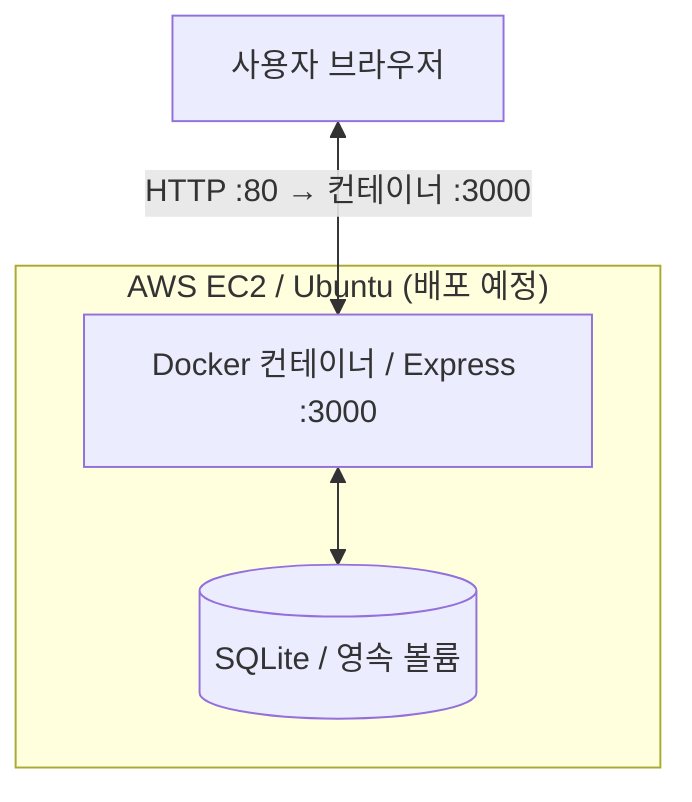

# Concert Ticketing — 콘서트 티켓 예매 웹서비스

> **클라우드컴퓨팅 Ch.10 AWS 프로젝트 적용 과제 | 프로젝트 설계 및 README 초안**  
> **진행 순서: 로컬 개발 → 로컬 기능·Docker 검증 → GitHub 반영 → AWS EC2 배포 → AWS 배포 주소에서 재검증.** 현재 AWS는 미배포 상태이며, 주소·시험 결과·제출 커밋은 직접 확인한 후 기입합니다.

## 1. 서비스 소개

**Concert Ticketing**은 사용자가 콘서트 공연 목록을 확인하고, 좌석을 선택해 예매하며, 자신의 예매 내역을 확인하거나 취소할 수 있는 웹서비스입니다. 인기 공연의 예매 오픈 직후 사용자가 몰리는 상황을 가정하여, **좌석 중복 예매 방지**와 클라우드 확장 가능성을 학습합니다.

- **대상 사용자:** 콘서트 관람을 원하는 일반 사용자
- **해결하려는 문제:** 공연 정보 탐색과 좌석 선택·예매를 한 화면에서 처리하고, 다수의 사용자가 같은 좌석을 동시에 예매하지 않도록 함
- **과제용 범위:** 모의 티켓팅 서비스. 실제 결제·개인정보 수집·실제 티켓 발급은 구현하지 않음

### 주요 기능

| 번호 | 사용자 기능 | 화면에서의 실행 방법 | 기대 결과 |
|---|---|---|---|
| 1 | 공연 목록 및 상세 조회 | 공연 카드 선택 | 공연 정보, 공연 날짜, 예매 가능 좌석 표시 |
| 2 | 좌석 선택 및 예매 | 빈 좌석 선택 → 닉네임 입력 → 예매 버튼 클릭 | 예매번호 발급 및 해당 좌석 예약 처리 |
| 3 | 예매 내역 조회 | 예매번호 입력 → 조회 버튼 클릭 | 예약한 공연·좌석·상태 표시 |
| 4 | 예매 취소 | 예매번호 조회 → 취소 버튼 클릭 | 예약 취소 및 좌석 재오픈 |
| 5 | 예매 입장 대기열 | 예매 가능 인원이 가득찬 상태에서 예매하기 선택 | 대기번호 표시, 순서가 되면 예매 화면 입장 |

**접속 집중 시나리오:** 인기 콘서트 티켓 오픈 직후 다수의 브라우저가 예매 화면 입장을 시도하거나 동일 좌석 예매를 동시에 요청하는 상황.

**대기열 범위:** 사이트 전체의 네트워크 접속 수 제한이 아니라 **예매 화면 활성 입장 수**를 제한합니다. 공연 목록은 대기 없이 볼 수 있도록 설계합니다.

### 동시성 및 검증 방침

- 좌석 상태는 브라우저가 아니라 **서버에서 최종 확인**합니다.
- `seats` 테이블에서 `(concert_id, seat_id)`를 고유하게 관리하고, 예약 처리 시 트랜잭션 안에서 **비어 있는 좌석만 조건부 UPDATE**해 선점합니다. 성공한 한 요청만 `reservations`에 저장합니다.
- 취소할 때는 해당 예약을 `cancelled`로 기록하고 같은 트랜잭션에서 좌석 점유를 해제해 **취소 이력을 보존하면서 재예매**를 허용합니다.
- 대기열은 서버가 입장 토큰·대기 순서·만료 시간을 관리하고, 예매 요청에도 유효한 입장 권한을 확인하도록 계획합니다. 새로고침/중복 요청으로 대기 순서가 중복 발급되지 않도록 처리합니다.
- 프런트엔드의 좌석 표시 상태는 참고용이며, 실제 예매 승인 여부는 API 응답으로 결정합니다.
- 본 과제는 모의 예매 시스템이며, 실제 결제 기능은 포함하지 않습니다.

## 2. 사용 기술

| 분류 | 기술 | 사용 목적 |
|---|---|---|
| 프런트엔드 | HTML5, CSS3, Vanilla JavaScript | 페이지·스타일·사용자 동작·Fetch API 요청 |
| 백엔드 | Node.js, Express | REST API, 예매·취소 처리, 정적 페이지 제공 |
| 데이터베이스 | SQLite (`better-sqlite3`) | 공연·좌석·예매 데이터 저장, 트랜잭션 처리 |
| 버전 관리 | Git, GitHub (Public) | 소스 코드 및 README 보존 |
| 배포 | AWS EC2 (Ubuntu) | 웹 서버 운영 및 외부 접속 |
| 실행 관리 | Docker, Docker Compose | 로컬 및 EC2에서 동일한 실행 방식 유지 |

> **선택 근거:** HTML·CSS·JavaScript로 사용자 인터페이스를 만들고, 서버에서도 JavaScript(Node.js)를 활용해 학습 부담을 줄입니다. 좌석 점유·취소 데이터를 브라우저별로 공유해야 하므로 정적 페이지뿐 아니라 API와 데이터베이스가 필요합니다. SQLite는 과제용 단일 EC2 구성에 적합합니다. 향후 다중 인스턴스로 확장한다면 공유형 RDS(PostgreSQL 등)로 전환해야 합니다.

## 3. 프로젝트 구조 (예정)

```text
Week10_Workout/
├── README.md                  # 프로젝트 안내 및 검증 기록
├── .gitignore
├── .env.example               # 설정값 예시 (실제 비밀정보 제외)
├── Dockerfile                 # Node.js 실행 이미지
├── compose.yaml               # 앱 및 영속 볼륨 설정
├── package.json               # 실행 명령 및 의존성
├── package-lock.json
├── public/                    # HTML / CSS / JavaScript 프런트엔드
│   ├── index.html             # 공연 목록
│   ├── concert.html           # 공연 상세 및 좌석 선택
│   ├── reservation.html       # 예매 내역 조회 및 취소
│   ├── waiting.html           # 입장 대기
│   ├── css/
│   │   └── style.css          # 공통 스타일
│   └── js/
│       ├── api.js             # Fetch API 공통 요청
│       ├── index.js           # 공연 목록 로딩
│       ├── concert.js         # 좌석 표시·예매 요청
│       ├── reservation.js     # 예매 조회·취소
│       └── waiting.js         # 대기번호·상태 갱신
├── server/
│   ├── app.js                 # Express 앱 진입점, 정적 파일 서빙
│   ├── db.js                  # SQLite 연결 및 초기 데이터
│   ├── routes/
│   │   ├── concerts.js        # 공연·좌석 조회 API
│   │   ├── reservations.js    # 예매·조회·취소 API
│   │   └── queue.js           # 대기열 입장·상태 API
│   └── services/
│       ├── booking.js         # 예매 검증·트랜잭션 로직
│       └── queue.js           # 활성 입장·순서·만료 처리
├── data/                      # SQLite 파일 (Git 추적 제외)
└── docs/
    └── screenshots/           # 제출용 화면 캡처(선택)
```

위 구조는 **개발 목표**이며, 실제 구현 후 파일과 명령을 맞춰 갱신합니다. `data/`, `.env` 및 DB 파일은 Git 추적에서 제외하고, 설정 예시는 `.env.example`로 제공합니다.

## 4. AWS 배포 구성도



**사용자 요청 경로:** 브라우저 → EC2 퍼블릭 IP(80번 포트) → Docker 포트 매핑 → Express(3000번 포트) → SQLite → API 응답 → 브라우저.

| AWS 서비스 | 역할 | 선택 이유 |
|---|---|---|
| EC2 | 서버에서 정적 페이지, API, DB 실행 | AWS 서비스를 1개 이상 사용한 실제 배포 및 기능 점검을 단순하게 구성 가능 |
| Security Group (EC2 방화벽 설정) | 웹 접속 및 관리 포트 제한 | 필요한 포트만 허용 |

- **현재 배포 계획:** EC2 한 대에 앱 컨테이너 실행. SQLite 데이터 파일은 영속 볼륨에 저장.
- **포트 계획:** 외부 `80/tcp` → 컨테이너 `3000/tcp`, SSH `22/tcp`는 관리자 IP로만 제한 권장.
- **접속 주소:** `http://<EC2_PUBLIC_IP>/` (**배포 후 실제 주소로 교체**)
- 운영 환경에서 공개 서비스를 장기 제공한다면 도메인과 HTTPS(TLS) 구성을 별도로 검토합니다.

## 5. 실행 방법 (구현 후 검증 예정)

### 준비 사항

- Git
- Node.js 및 npm (직접 실행할 경우)
- Docker 및 Docker Compose (컨테이너 실행할 경우)
- AWS 계정과 EC2 접근용 SSH 키 (배포할 경우)

### 로컬에서 실행

```bash
git clone https://github.com/qkrgusrb0123a-ui/Week10_Workout.git
cd Week10_Workout
npm install
npm start
```

브라우저에서 `http://localhost:3000` 접속.

또는 Docker Compose 사용:

```bash
docker compose up -d --build
docker compose ps
```

브라우저에서 `http://localhost` 접속 (호스트 `80:3000` 포트 매핑 기준).

> 위 실행 명령과 포트는 **계획값**입니다. 파일 구현 후 실제 로컬 PC에서 확인하고 수정합니다. Docker 검증에서는 DB 영속 볼륨이 재시작 뒤에도 유지되는지도 확인합니다.

### 로컬 완료 조건 (AWS 배포 전)

1. 서버 실행과 `/api/health` 응답 확인
2. 공연 조회·예매·조회·취소·대기열의 정상 및 실패/경계 시험
3. 서로 다른 브라우저에서 같은 좌석 동시 요청 시 **한 건만 성공**하는지 확인
4. 예매 취소 후 재예매 및 서버 재시작 후 기록 유지 확인
5. `docker compose up -d --build`와 종료/재시작 후 동작 확인
6. 로컬 결과를 기록하고 GitHub에 코드·README를 반영한 뒤 AWS 배포 시작

### AWS EC2 배포 절차 (예정)

1. AWS EC2에서 Ubuntu 인스턴스를 생성합니다.
2. EC2 보안 그룹에서 `80/tcp` 웹 접속을 허용하고, `22/tcp`는 본인 IP만 허용합니다.
3. EC2에 SSH로 접속한 뒤 Git과 Docker Engine/Compose 플러그인을 설치합니다.
4. Public GitHub 저장소에서 소스를 내려받습니다.
5. EC2의 프로젝트 디렉터리에서 `docker compose up -d --build` 실행합니다.
6. `docker compose ps`, `docker compose logs`로 상태를 확인합니다.
7. 브라우저에서 `http://<EC2_PUBLIC_IP>/`로 접속하고 기능 **5개**의 정상 및 실패/경계 동작을 다시 검증합니다.
8. 제출 및 검사 완료 시까지 서비스 배포 상태를 유지합니다.

**검증 후 기입할 정보**

| 항목 | 값 |
|---|---|
| AWS 배포 주소 | `미배포` |
| GitHub 저장소 | [qkrgusrb0123a-ui/Week10_Workout](https://github.com/qkrgusrb0123a-ui/Week10_Workout) (**Public, 연결 확인**) |
| 제출 버전 (커밋 해시 또는 태그) | `미확정` |
| 로컬 검증 일시 및 환경 | `미검증` |
| AWS 검증 일시 및 환경 | `미검증` |

## 6. API 설계 (예정)

| Method | 경로 | 동작 | 주요 응답 |
|---|---|---|---|
| GET | `/api/health` | 서버 상태 확인 | `200 OK` |
| GET | `/api/concerts` | 공연 목록 조회 | 공연 배열 |
| GET | `/api/concerts/:id` | 공연 상세 및 좌석 조회 | 공연 및 좌석 상태 |
| POST | `/api/reservations` | 좌석 예매 | `201 Created` / `409 Conflict` |
| GET | `/api/reservations/:code` | 예매번호로 내역 조회 | `200 OK` / `404 Not Found` |
| DELETE | `/api/reservations/:code` | 예매 취소 | `200 OK` / `404 Not Found` / `409 Conflict` |
| POST | `/api/queue/join` | 예매 화면 입장 요청 | 입장 토큰 또는 대기번호 |
| GET | `/api/queue/:ticketId` | 대기 상태·순서 확인 | 대기 / 입장 가능 / 만료 |
| POST | `/api/queue/:ticketId/leave` | 입장 종료·대기 취소 | 종료 결과 |

**예매 요청 예시**

```json
{
  "concertId": 1,
  "seatId": "A-01",
  "nickname": "guest01"
}
```

실제 API와 응답 구조는 구현 과정에서 확정합니다. 대기열 토큰은 예매 승인 시에도 서버에서 검증하며, 활성 입장 수 제한·토큰 만료·연결 종료 시 슬롯 반환을 구현합니다. 단일 서버 과제이므로 대기열 상태는 **서버 메모리**에 둘 수 있지만 서버 재시작 시 초기화됨을 문서화하고, 필요하면 SQLite에 저장합니다. 개인정보 노출을 줄이기 위해 **모의 닉네임·무작위 예매번호**를 사용하며, 실제 서비스 수준의 인증을 제공하지 않습니다.

## 7. 기능별 시험 계획 및 직접 검증 기록

**요구사항:** 기능별로 정상 시험 1건과 실패 또는 경계 시험 1건을 수행하고, 입력·기대 결과·실제 결과를 기록합니다. **먼저 로컬에서 수행하고, 배포 후 AWS 주소에서 동일 시험을 다시 수행**합니다. 아래 표는 AWS 최종 검증 기록용이며 실제 결과는 아직 미실행 상태입니다.

| 기능 | 시험 유형 | 입력·동작 | 기대 결과 | 실제 결과 | 판정 |
|---|---|---|---|---|---|
| 공연 조회 | 정상 | 공연 카드 선택 | 상세 정보 및 좌석 표시 | 미실행 | 미판정 |
| 공연 조회 | 실패 | 존재하지 않는 공연 ID 접근 | 찾을 수 없음 안내 | 미실행 | 미판정 |
| 좌석 예매 | 정상 | 빈 좌석 A-01, 닉네임 `guest01` | 예매번호 생성, 좌석 예약됨 | 미실행 | 미판정 |
| 좌석 예매 | 실패 | 이미 예약된 A-01 재예매 | 예매 거절, 중복 예약 없음 | 미실행 | 미판정 |
| 예매 조회 | 정상 | 발급받은 예매번호 입력 | 예매 내역 표시 | 미실행 | 미판정 |
| 예매 조회 | 실패 | 존재하지 않는 예매번호 입력 | 조회 실패 안내 | 미실행 | 미판정 |
| 예매 취소 | 정상 | 예약된 예매번호로 취소 | 취소 완료, 좌석 재오픈 | 미실행 | 미판정 |
| 예매 취소 | 경계 | 이미 취소한 예매번호 재취소 | 중복 취소 방지 안내 | 미실행 | 미판정 |
| 입장 대기 | 정상 | 활성 입장 인원 제한 미만에서 예매하기 클릭 | 예매 화면 입장 허용 | 미실행 | 미판정 |
| 입장 대기 | 경계 | 활성 입장 인원 제한을 채운 뒤 다른 브라우저로 예매하기 클릭 | 대기번호 표시 및 예매 화면 입장 제한 | 미실행 | 미판정 |
| 입장 대기 | 정상(추가) | 활성 사용자가 퇴장한 뒤 대기 순서 도달 | 다음 대기자에게 입장 권한 부여 | 미실행 | 미판정 |
| 입장 대기 | 실패(추가) | 만료되거나 유효하지 않은 토큰으로 예매 요청 | 서버가 입장/예매 요청 거절 | 미실행 | 미판정 |

> 로컬 시험 결과는 개발 기록으로 별도 보관하고, **최종 제출용 검사는 AWS 배포 주소에서** 직접 수행합니다. 실제 결과에는 화면 상태 또는 HTTP 응답·기록 시각 등 실제로 확인한 내용을 기입합니다. 대기열 시험을 위한 활성 입장 제한 인원은 로컬에서 낮게 설정해 재현 가능하도록 합니다.

## 8. ELB 및 Auto Scaling 확장 검토

| 항목 | 이번 과제 적용 여부 | 판단 근거 |
|---|---|---|
| Elastic Load Balancing (ALB) | **미적용 예정** | 단일 EC2의 소규모 모의 티켓팅 서비스로, 추가 비용 및 운영 복잡도를 줄임 |
| EC2 Auto Scaling | **미적용 예정** | 서버 1대로 기본 기능 검증 가능하며, 실측 부하 데이터가 없음 |

**향후 확장 방향:** 인기 콘서트 예매 오픈 시 요청량이 증가하면 ALB를 이용해 여러 서버로 요청을 분산하고, EC2 Auto Scaling으로 서버 수를 조정할 수 있습니다. 단, 이 경우 SQLite의 로컬 파일은 인스턴스 사이에서 공유할 수 없으므로 **RDS PostgreSQL 같은 공용 데이터베이스로 전환**해야 합니다. 중복 예약 방지는 서버 수와 무관하게 DB 트랜잭션과 고유 제약으로 보장해야 합니다.

이번 과제에서는 비용을 고려하여 ELB/Auto Scaling의 **적용 여부와 근거를 문서로 설명**하고, 실제 구축은 생략합니다.

## 9. AI 활용 기록 및 직접 구현 확인

과제 규정에 따라 **일반 AI를 이용한 개념 질문, 구조 설계, 코드 설명 및 검토**는 허용되지만 **Codex, Cursor, Claude Code, Google Antigravity 등 에이전틱 코딩 도구는 사용하지 않습니다.**

| 항목 | 기록 |
|---|---|
| AI 사용 여부 | 사용 |
| 도구 | ChatGPT |
| 활용 범위 | 과제 요구사항 해석, 기술 비교, 프로젝트 구조·시험 계획 검토, README 수정 |
| 직접 확인한 결과 | README 구성 및 과제 조건 대조 (코드 구현·AWS 배포·기능 시험은 아직 미실시) |
| 후속 기록 | 추후 AI를 사용한 코드 설명·검토 등이 있으면 추가 기입 |

> 소스 코드의 실제 구현 및 실행 검증은 과제의 AI 사용 제한을 준수하여 직접 진행합니다.

## 10. 제출 전 확인 사항

- [x] GitHub 원격 저장소 생성 및 **Public** 설정 확인
- [ ] 수정된 README와 실제 소스 파일 GitHub에 업로드
- [ ] 사용자 기능 3개 이상 구현 및 브라우저에서 시연
- [ ] 모든 기능 및 Docker 로컬 검증 완료
- [ ] AWS 서비스 1개 이상 사용해 실제 배포
- [ ] 배포 주소에서 기능별 정상 1건 + 실패/경계 1건 검증
- [ ] 배포 주소, GitHub 링크, 제출 커밋 해시 기록
- [ ] 주소창과 메인 화면이 함께 보이는 배포 스크린샷 확보
- [ ] 제공된 제출 양식에 **스크린샷 3장** 및 기능 시험 결과 반영
- [ ] AI 사용 여부·범위·직접 확인 결과 기록
- [ ] 검사 완료까지 AWS 배포 유지
- [ ] PDF 파일명 **`학번_이름.pdf`**로 제출, 기한 엄수
- [ ] 검사 후 불필요한 AWS 자원 정리, GitHub 저장소와 README 보존

---

**저장소:** https://github.com/qkrgusrb0123a-ui/Week10_Workout  
**AWS 주소:** 미배포 (로컬 검증 후 추가)

**참고:** 강의자료 *클라우드 컴퓨팅 Ch.10 AWS 프로젝트 적용* (서비스 구현, AWS 배포, 검증, README, ELB/Auto Scaling 및 AI 사용 규정). 이 README의 기술 스택·주제·폴더 구조는 콘서트 티켓팅 주제에 맞추어 새로 설계한 내용입니다.
